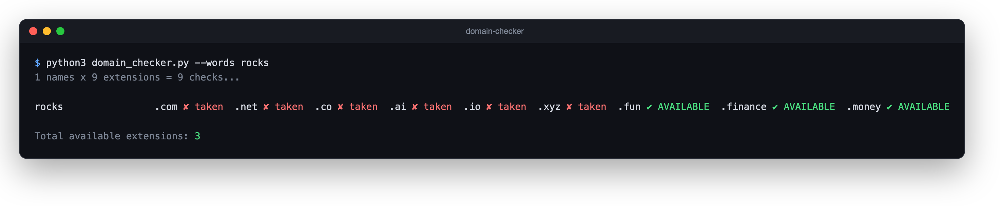
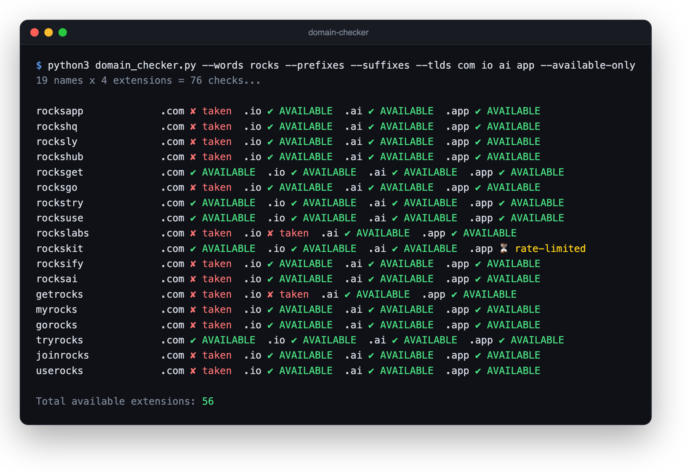

# domain-checker

Give it a few words and it tells you which domains you can still register.

It's one Python file with no dependencies. It builds name variations from your
words and checks each one against a list of extensions in parallel, using RDAP
where the registry offers it and `whois` where it doesn't. You don't need API
keys or an account anywhere.



## Quick start

```bash
git clone https://github.com/utkurock/domain-checker.git
cd domain-checker
python3 domain_checker.py --words rocks
```

You need Python 3.9 or newer and the `whois` command. macOS ships with it. On
Debian or Ubuntu, run `sudo apt install whois`.

## Default extensions

With no `--tlds` flag, every name is checked against these nine:

```
.com  .net  .co  .ai  .io  .xyz  .fun  .finance  .money
```

Use `--extra app dev gg` to check more on top of the defaults. If you only care
about a few, `--tlds com io` replaces the list.

## Generating names

A plain dictionary word is almost always taken on `.com`, so the script can
build variations for you. `--suffixes` adds endings like `hq`, `ly` and `kit`,
`--prefixes` puts `get`, `try` or `join` in front, and `--combos` glues your
words together in pairs. With `--available-only` you only see rows that have at
least one free extension.



That run turned `rocks` into 19 names and 76 lookups, and five names came back
free on `.com`. The `.app` lookup for `rockskit` hit a rate limit. That happens
now and then, and running the one name again with `--workers 1` sorts it out.

A few more ways to feed it words:

```bash
# pair words together
python3 domain_checker.py --words alpha beta --combos --available-only

# read words from a file, one per line
python3 domain_checker.py --file examples/words.txt

# pipe words in
echo "example sample" | python3 domain_checker.py --stdin --prefixes

# stop after the first 50 generated names
python3 domain_checker.py --words rocks --suffixes --prefixes --max 50
```

## Flags

| Flag | What it does |
|------|--------------|
| `--words w1 w2 ...` | base words |
| `--file PATH` | read words from a file, one per line |
| `--stdin` | read words from stdin |
| `--combos` | word pairs (`alpha` + `beta` → `alphabeta`) |
| `--suffixes` | add `app, hq, ly, go, hub, get, try, use, labs, kit, ify, ai` to the end |
| `--prefixes` | add `get, my, go, try, join, use` to the front |
| `--tlds ...` | replace the default extension list |
| `--extra ...` | check these extensions as well as the list |
| `--available-only` | hide names where every extension is taken |
| `--max N` | check at most N names |
| `--workers N` | parallel lookups, default 6 |

## Using it with an AI agent

The repo includes an [`AGENTS.md`](AGENTS.md), and `CLAUDE.md` points to it, so
Claude Code, Codex, Cursor and similar agents pick up the instructions when you
open the folder. Then you can ask for a domain in plain language:

```
I'm building a budgeting app. Find me a domain, seed words: rocks, stack.
```

If you haven't said what the project is, the agent asks. It shows you the nine
default extensions and asks whether you want extras such as `.app`, `.dev`,
`.gg`, `.org`, `.so` or `.tech`. After that it writes candidates, runs the
checker and hands back a short list with the names that are free on `.com` at
the top.

## How a lookup works

For most extensions the script asks the registry's RDAP server. It finds that
server through IANA's bootstrap file, which it downloads once per run. A `404`
means nobody holds the name, and a `200` means someone does.

`.com`, `.net` and `.co` don't have a public RDAP endpoint that works for this,
so those go to `whois`. A reply containing "No match" or "NOT FOUND" counts as
available. If the RDAP lookup for any other extension fails, the script tries
`whois` instead.

## Things to know

"Available" means nobody has registered the name. It doesn't tell you the price.
Registries hold back premium and reserved names that look free here and then
cost far more than the normal fee at checkout, so confirm the price at a
registrar before you get attached to one.

`whois` servers rate-limit quickly. If you see `⚠ error`, `? unknown` or
`⏳ rate-limited`, re-run those names with a lower `--workers` value.

A result is only true at the moment of the lookup. Someone can register the name
a minute later.

## License

MIT. See [LICENSE](LICENSE).
